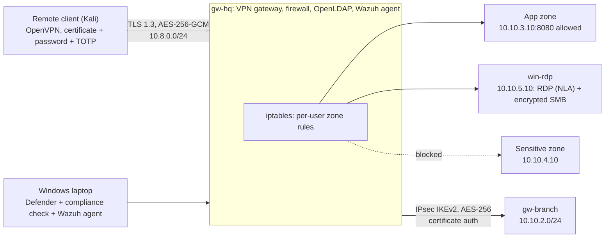
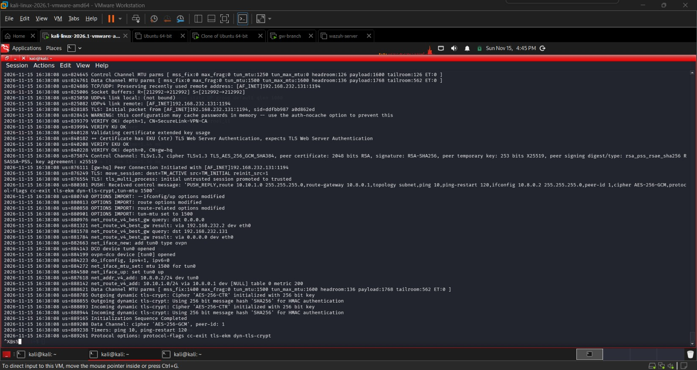
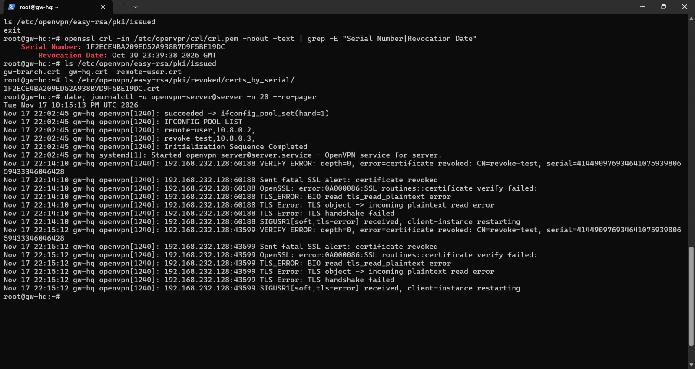
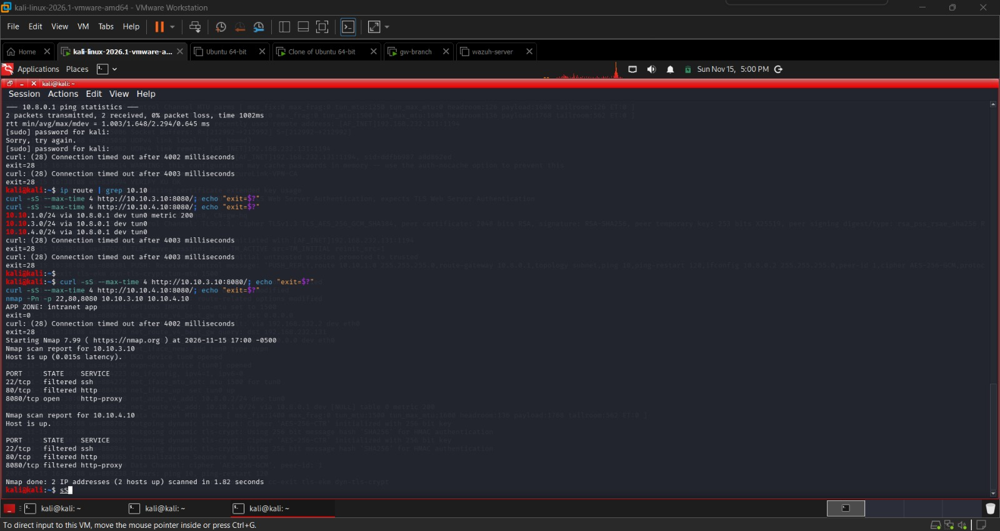
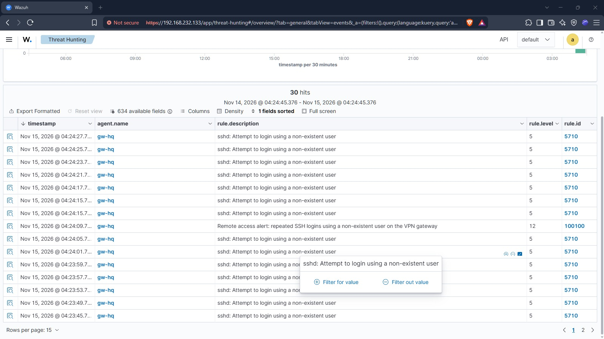

<h1 align="center">Secure Remote Access Solution</h1>
<p align="center">
  A hands-on lab that designs, builds, tests and assesses a secure remote access platform:<br>
  VPN, multi-factor authentication, zero trust segmentation, endpoint compliance and monitoring.
</p>
<p align="center">
  
  
  
  
  
</p>

## Overview

A global company needs employees to reach internal systems safely from home or while travelling. This project delivers a working design in a VMware lab, tests it from a remote client's point of view, then records what still needs fixing.

| Result | Value |
|---|---|
| Tests passed | **44** |
| Findings recorded | **16** (4 High, 8 Medium, 4 Low) |
| Remediated in the lab | 3 |
| Evidence screenshots | 96 |
| Design and plan documents | 10 |

## Architecture



## What was built

| Area | Implementation |
|---|---|
| Encryption | OpenVPN (TLS 1.3, AES-256-GCM, tls-crypt) and site-to-site IPsec IKEv2 with AES-256 |
| Authentication | Client certificates, OpenLDAP identity, TOTP second factor through PAM |
| Revocation | CRL enforced on OpenVPN; revoked certificate rejected at the TLS handshake |
| Zero trust | Default-deny INPUT rules, per-user forwarding, isolated app and sensitive zones |
| Remote tools | RDP with NLA and lockout policy; SMB share with enforced encryption and least-privilege ACLs |
| Endpoint | Defender and ClamAV checks, PowerShell compliance script, Wazuh SCA |
| Monitoring | Wazuh agents and a custom level-12 rule for repeated SSH failures |
| People and policy | Security awareness training with quiz, remote access policy, compliance mapping |

## Lab environment

| Machine | Role |
|---|---|
| `gw-hq` | Hub gateway: OpenVPN, strongSwan, OpenLDAP, PAM + TOTP, iptables, Wazuh agent |
| `gw-branch` | Branch gateway at the other end of the IPsec tunnel |
| Kali Linux | Remote VPN client and test machine |
| `win-laptop` | Windows endpoint: Defender, compliance script, Wazuh agent |
| `win-rdp` | Windows Server for RDP and the encrypted SMB share |
| Wazuh server | Central monitoring and custom alert rules |

Built on VMware with isolated host-only networks.

## Skills demonstrated

VPN design (OpenVPN and IPsec) · PKI and certificate revocation · LDAP and MFA integration · Linux firewalling (iptables) · network segmentation and zero trust · Windows hardening (RDP, SMB, Defender) · SIEM and custom detection rules (Wazuh) · risk scoring (likelihood x impact) · security documentation and policy writing · security awareness training

## Selected evidence

| | |
|---|---|
| <br>**TLS 1.3 + AES-256-GCM tunnel established** | <br>**Revoked certificate rejected by the gateway** |
| <br>**App zone reachable, sensitive zone filtered** | <br>**Custom Wazuh rule 100100 firing** |

## Repository layout

```
docs/            10 design, plan and assessment documents (PDF; editable .docx in docs/source)
presentations/   Project summary and user security awareness training
evidence/        Lab screenshots grouped by task, with an index
hardening/       Proposed fixes for open findings (untested)
```

Start with [`docs/01_Remote_Access_Solution_Design_Document.pdf`](docs/01_Remote_Access_Solution_Design_Document.pdf), then the [assessment report](docs/09_Practical_Task1_Remote_Access_Assessment_Report.pdf) and the [remediation roadmap](docs/remediation-roadmap.md).

## Known limitations

- Endpoint compliance is shown as a standalone script; it is not yet wired to VPN login ([A-13](docs/remediation-roadmap.md)).
- IPsec certificate revocation is not enforced ([A-05](docs/remediation-roadmap.md)).
- The RDP test used `/cert:ignore` ([A-10](docs/remediation-roadmap.md)).
- 13 findings remain open or accepted; the plan is in the [roadmap](docs/remediation-roadmap.md).
- Files in `hardening/` are proposals and have not been validated in the lab.

## Disclaimer

This is an educational lab built in an isolated environment. Credentials, keys and certificates are not included. Do not apply these configurations to production systems without testing.

## Author

**Kshitij Rajesh Randhire**, cybersecurity analyst · [GitHub](https://github.com/kshitij-soc)

Released under the [MIT License](LICENSE).
